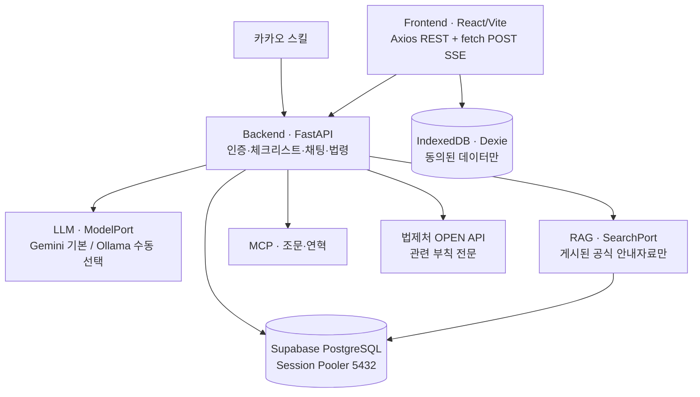
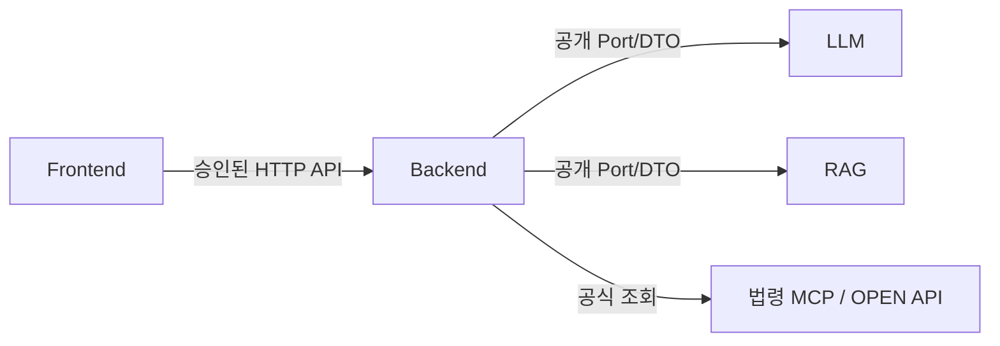

<!-- 책임: [통합] 서비스의 개발 경계와 데이터 흐름을 정의한다.
구현할 기능: 각 서비스가 무엇을 호출하고 무엇을 저장하는지 표시한다.
완료 기준: 데이터 흐름, 소유 영역, 금지 의존성을 한 페이지에서 확인한다. -->
# 시스템 아키텍처 — 네 영역과 연결 규칙

**문서 버전:** v1  
**목적:** 영역별 책임과 데이터 흐름을 정의한다.  
**적용:** 현재 최소 실행 코드베이스의 개발 경계. **전체 아키텍처와 ERD는 별도 최종 승인 전**이다.

## 1. 시스템 연결

| 영역 | 책임 | 금지 사항 |
|---|---|---|
| `frontend/` | 화면·HTTP·메모리 상태·선택적 로컬 저장 | 법률 판단 로직 중복 구현 금지 |
| `backend/` | 업무 규칙·인증·AI 호출 조립·법령 근거 | 서버 채팅 원문 영구 저장 금지 |
| `llm/` | `ModelPort.generate/stream`, Gemini/Ollama 실행 | Backend 내부 코드 import 금지 |
| `rag/` | Docling·임베딩·pgvector·`SearchPort.search` | 법령 원문 색인·미게시 자료 검색 금지 |

## 2. 코드 의존 방향

- `llm ↔ rag` 간 import와 `llm/rag → backend` 역참조는 **금지**한다.
- Frontend의 REST는 공통 Axios를 사용한다. **POST SSE 수신만 `fetch`**를 사용한다.
- 인증: 자체 FastAPI JWT(Access 15분), HttpOnly 회전 Refresh(7일), CSRF·정확한 CORS Origin. Supabase Auth는 사용하지 않는다.
- 법령: MCP로 조문·연혁 조회. 관련 부칙 **전문**은 OPEN API에서 조회한다. 자동 후보 선정은 필요한 경우에만 구현한다.
- 배포 방향: Render Static Site + Web Service. Browser Refresh 쿠키는 Chrome·Safari·Firefox·카카오 인앱에서 검증한다. CHIPS는 필요 시 검토한다.

## 3. 실제 완료 범위

| 현재 확인 가능 | 아직 미완료 |
|---|---|
| `/health` 응답, Frontend 초기 화면, LLM/RAG CLI `status` | 실제 가입·로그인, Gemini/Ollama 생성, Docling 적재, pgvector 검색, 브라우저 인증 통합 |

**관련 정본:** 파일 경로는 [`PROJECT_STRUCTURE_GUIDE.md`](PROJECT_STRUCTURE_GUIDE.md), 함수 계약은 [`contracts/INTERFACE_FINAL_v1.md`](contracts/INTERFACE_FINAL_v1.md)를 본다.
