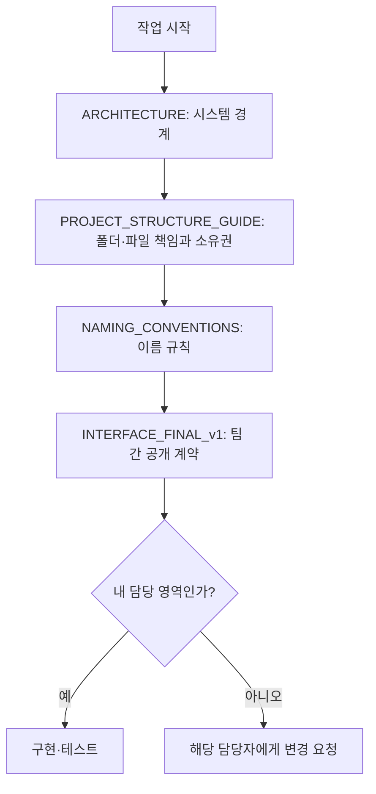

<!-- 책임: [통합] 개발 문서의 읽는 순서와 적용 기준을 안내한다.
구현할 기능: 필수 문서 5개의 읽는 순서를 안내한다.
완료 기준: 팀원과 코딩 에이전트가 이 문서만 읽고 다음 문서를 선택한다. -->
# 개발 문서 읽는 순서 — 5개 정본

**문서 버전:** v1  
**목적:** 처음 참여한 개발자와 코딩 에이전트가 개발 기준을 빠르게 찾는다.  
**적용:** Frontend, Backend, LLM, RAG 전 영역.  
**상태:** 내부 인터페이스 설계 결정 완료. 실제 업무 기능 및 전체 아키텍처·ERD의 최종 승인은 별도다.

## 1. 처음 읽는 순서

| 순서 | 정본 | 이 문서가 답하는 질문 |
|---|---|---|
| 1 | [`ARCHITECTURE.md`](ARCHITECTURE.md) | 어떤 영역이 누구를 호출하고 무엇을 저장하는가? |
| 2 | [`PROJECT_STRUCTURE_GUIDE.md`](PROJECT_STRUCTURE_GUIDE.md) | 코드를 어디에 만들고, 누가 수정할 수 있는가? |
| 3 | [`NAMING_CONVENTIONS.md`](NAMING_CONVENTIONS.md) | 클래스·파일·함수·DB 이름과 주석은 어떻게 작성하는가? |
| 4 | [`contracts/INTERFACE_FINAL_v1.md`](contracts/INTERFACE_FINAL_v1.md) | 다른 영역과 어떤 함수·DTO·오류로 연결하는가? |

## 2. 작업 전 확인

1. 루트와 담당 폴더의 `AGENTS.md` 또는 `CLAUDE.md`를 읽는다.
2. 수정할 파일의 **소유자**를 `PROJECT_STRUCTURE_GUIDE.md`에서 확인한다.
3. 영역 간 공개 함수·DTO를 바꾸기 전에는 계약 소유자와 소비자의 승인을 받는다.
4. 승인 전인 ERD·DB 테이블·마이그레이션을 임의로 만들지 않는다.
5. 테스트한 범위만 완료로 보고한다.

**문서 원칙:** 짧은 문장을 사용한다. 같은 개념은 같은 용어로 쓴다. 흐름은 표와 다이어그램으로 보여준다. ASD-STE100의 명료성 원칙을 한국어에 맞게 적용한다.

**기존 문서 삭제 범위:** 설치·RAG 의존성·CI 권고·독립 소유권 문서는 이 정본 목록에서 제외한다. 실행 명령은 루트 `RUN_FIRST.md`, 의존성 등록은 해당 `pyproject.toml`·`package.json`을 따른다.
