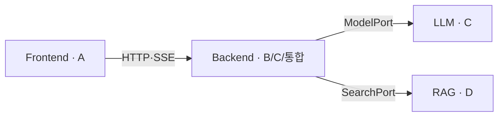
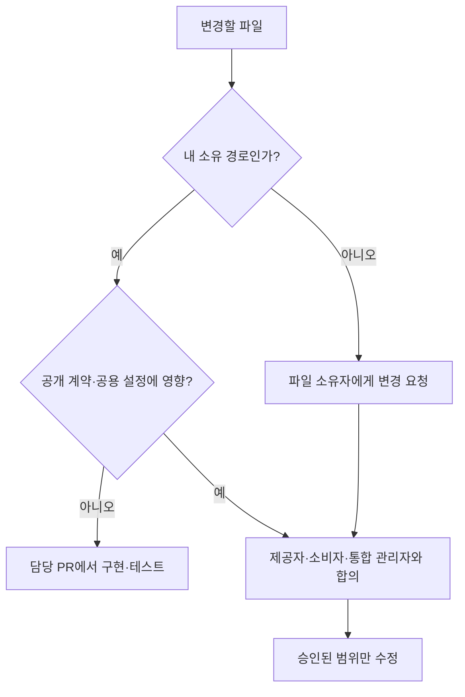

<!-- 책임: [통합] 모노레포의 폴더/핵심 파일 역할과 수정 소유권을 정의한다.
구현할 기능: 폴더별 책임과 수정 소유권을 정의한다.
완료 기준: 개발자가 배치 위치, 직접 수정 허용 범위, 승인 요청 대상을 이 문서 하나로 확인한다. -->
# 프로젝트 구조·파일 소유권 — 어디에 만들고 누가 수정하는가

**문서 버전:** v1  
**목적:** 코드 위치와 담당 경계를 통일해 병렬 작업 충돌을 막는다.  
**적용:** 현재 FastAPI·React/Vite·uv Workspace 구조. ERD와 전체 아키텍처는 별도 최종 승인 전이다.

## 1. 모노레포와 의존 방향

```text
starter-kit/
├── frontend/                 [A] React·Vite 브라우저 앱
├── backend/src/inheritance/ [B·C·통합] FastAPI 앱
├── llm/starter_llm/          [C] Gemini·Ollama 공통 모델 패키지
├── rag/starter_rag/          [D] Docling·임베딩·검색 패키지
├── tests/                    [통합] 계약·진입점 테스트
├── scripts/                  [통합] 계약 검사
├── .github/workflows/        [통합] CI·배포 설정
├── docs/                     [통합] 5개 개발 정본
├── pyproject.toml            [통합] uv Workspace 설정
└── .env.example              [통합] 단일 환경변수 예시
```



**경계:** `llm/`과 `rag/`는 서로의 내부 모듈을 import하지 않는다. 두 패키지에서 Backend를 역참조하지 않는다. 외부 공개 계약은 [`contracts/INTERFACE_FINAL_v1.md`](contracts/INTERFACE_FINAL_v1.md)를 따른다.

## 2. 폴더별 책임

### 2.1 Frontend — `frontend/src/` (A 담당)

```text
src/
├── main.tsx              # React 시작
├── app.tsx               # 앱 화면·라우팅 조립
├── index.css             # Tailwind v4 전역 스타일
├── components/ui/        # shadcn 스타일 공통 UI
├── features/
│   ├── auth/             # 가입·로그인 화면
│   ├── checklist/        # 초기·위험 질문, 공통 8개 절차 안내
│   ├── chat/             # 채팅, POST SSE
│   ├── kakao/            # 웹 Handoff 수신
│   ├── law/              # 법령 안내
│   ├── procedures/       # 절차 상세
│   └── reports/          # 오류 제보
├── shared/
│   ├── api/              # Axios, 인증, OpenAPI 생성 타입
│   ├── contracts/        # 프론트엔드 공통 타입
│   ├── state/            # Zustand 메모리 상태
│   └── storage/          # Dexie 저장과 사용자 동의
└── lib/utils.ts          # 공통 cn() 유틸
```

| 위치 | 책임 |
|---|---|
| `shared/api/client.ts`, `auth.ts` | REST용 Axios, Access/Refresh 처리 |
| `shared/api/schema.d.ts` | 승인된 OpenAPI에서 생성한 타입 |
| `features/chat/use-chat-stream.ts` | `fetch` POST SSE 수신·취소 |
| `shared/state/` | 영속 저장하지 않는 화면 상태 |
| `shared/storage/` | 동의된 데이터만 IndexedDB 저장 |
| `components/ui/` | 여러 기능에서 재사용할 UI 구성요소 |

**배치 기준:** 한 도메인 전용 코드는 `features/<domain>/`에 둔다. 여러 도메인이 쓰면 `shared/`에 둔다. 필요할 때만 도메인 내부 `pages/`, `components/`, `lib/hooks/`, `types/`를 만든다.

### 2.2 Backend — `backend/src/inheritance/` (B·C·통합 담당)

```text
inheritance/
├── main.py               [통합] FastAPI 앱·lifespan
├── core/                 [통합] 설정, DB 세션, DI, 오류, 보안, health
├── auth/                 [통합] 회원가입·로그인·JWT·Refresh
├── contracts/            [통합] 팀 간 공통 DTO·Protocol
├── checklist/            [B] 공통 8개 절차 안내·질문 규칙
├── chat/                 [B] 채팅 답변 조립·문맥·출처 검증
│   └── services/         answer, context, prompt_builder,
│                        citation_validation
├── law/                  [B] MCP 조문·연혁 / OPEN API 부칙
└── kakao/                [C] 카카오 Skill JSON·Handoff
```

| 파일/패턴 | 책임 |
|---|---|
| `main.py`, `core/health.py` | FastAPI 생성·`/health` |
| `core/config.py`, `database.py`, `dependencies.py` | 환경변수, Session Pooler 연결, Port 주입 |
| `auth/{router,service,jwt,password}.py` | 자체 인증, JWT, Argon2id |
| `contracts/*.py` | 다른 영역과 공유할 내부 DTO |
| `<domain>/router.py` | HTTP 요청 접수. 와이어 규격은 API 담당 승인 |
| `<domain>/schemas.py` | 요청·응답 스키마 |
| `<domain>/service.py` | 도메인 유스케이스 |
| `<domain>/repository.py` | DB 접근. ERD 승인 전 테이블 확정 금지 |
| `checklist/{rules,service}.py` | 입력 기반 안내·위험 정보를 반영한 공통 8개 절차 안내 |
| `chat/services/{answer,prompt_builder,citation_validation}.py` | 질문 처리, 프롬프트, 근거 검증 |
| `law/{mcp_client,open_api,service}.py` | 조문·연혁·부칙 전문 조회 |
| `kakao/adapter.py`, `kakao/handoff/` | 외부 JSON 변환, 10분·1회 토큰 |

### 2.3 LLM — `llm/starter_llm/` (C 담당)

| 위치 | 책임 |
|---|---|
| `contracts/{ports,models,errors,profiles}.py` | `ModelPort.generate/stream`, DTO·오류 |
| `providers/{gemini,ollama,factory}.py` | 공급자 구현과 수동 선택 |
| `runtime/{client,lifecycle,settings,prompts}.py` | 요청·취소·5분 유휴 자원 정리 |
| `cli.py` | 독립 CLI 진입점, `starter-llm status` |

**금지:** `llm/` 아래에 `src/`를 추가하지 않는다. Backend 도메인이나 `rag/` 내부 모듈을 import하지 않는다.

### 2.4 RAG — `rag/starter_rag/` (D 담당)

| 위치 | 책임 |
|---|---|
| `contracts/{ports,models}.py` | `SearchPort.search`, Evidence·SourceRef |
| `ingestion/{parser,chunking,service,cli}.py` | Docling 파싱·청킹·적재·검수 |
| `embedding/model.py` | EmbeddingGemma 2 임베딩 |
| `storage/{vector_store,publication,models}.py` | pgvector, 문서 메타·게시 상태 |
| `retrieval/{search,pipeline}.py` | `published` 문서만 검색 |
| `evaluation/golden_set.py` | 검색 평가용 Golden Set |
| `cli.py` | 독립 CLI 진입점, `starter-rag status` |

**금지:** 서버 시작 시 자동 적재하지 않는다. 법령 원문을 벡터 색인하지 않는다. 미게시 자료를 검색에 넣지 않는다.

## 3. 소유권 — 직접 수정할 수 있는 경로

**원칙:** 다른 담당자의 파일은 읽을 수 있다. **수정·이동·삭제·일괄 포맷·생성 결과 덮어쓰기**는 금지한다.

| 담당 | 직접 수정할 경로 | 주된 책임 |
|---|---|---|
| **A · Frontend** | `frontend/**` | UI, Axios, SSE, Zustand, Dexie |
| **B · Backend 도메인** | `backend/src/inheritance/checklist/**`, `chat/**`, `law/**` | 절차 안내·채팅·법령 조회 |
| **C · 카카오/LLM** | `backend/src/inheritance/kakao/**`, `llm/**` | 카카오 Handoff, Gemini/Ollama |
| **D · RAG** | `rag/**` | Docling, 임베딩, 검색, 게시 |
| **통합 관리자** | 루트 설정, `backend/src/inheritance/{auth,core,contracts}/**`, `main.py`, `backend/migrations/**`, `tests/**`, `scripts/**`, `.github/**`, `docs/**` | 인증·DB·DI·계약·CI·문서 |
| **API 담당자** | HTTP 공개 규격의 **정의·승인** | URL·Method·JSON·SSE 이벤트. 실제 수정은 파일 소유자와 협의 |

**예외:** 각 영역의 `pyproject.toml`·`package.json` 변경은 해당 소유자가 제안할 수 있다. 루트 의존성·lockfile·공개 Port·OpenAPI의 변경은 통합 관리자 승인도 필요하다.

## 4. 파일을 변경하기 전 판단



- 소유자가 불분명하면 통합 관리자에게 확인한다.
- 자동 포맷은 **본인 소유 영역**에만 적용한다.
- ERD 승인 전 SQL 테이블·Alembic revision을 만들지 않는다.
- 공용 DTO·Port를 바꿀 때는 영향받는 팀원의 승인을 받고 테스트한다.
- 파일 상단의 책임 주석이 이 문서와 충돌하면 임의로 수정하지 않고 통합 관리자에게 보고한다.

**이름 규칙:** [`NAMING_CONVENTIONS.md`](NAMING_CONVENTIONS.md).
