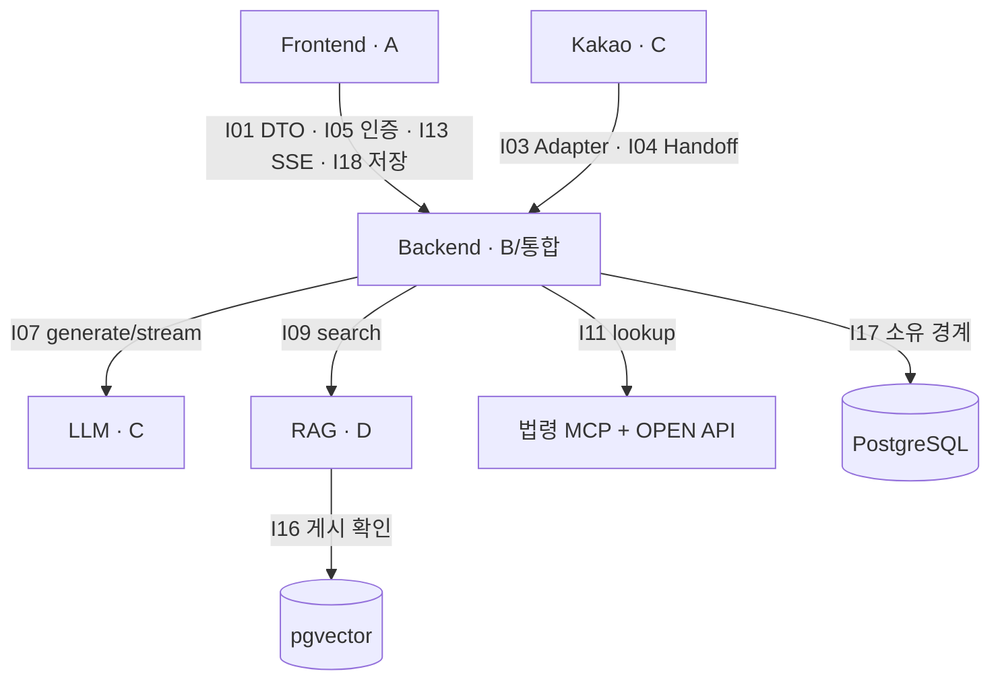
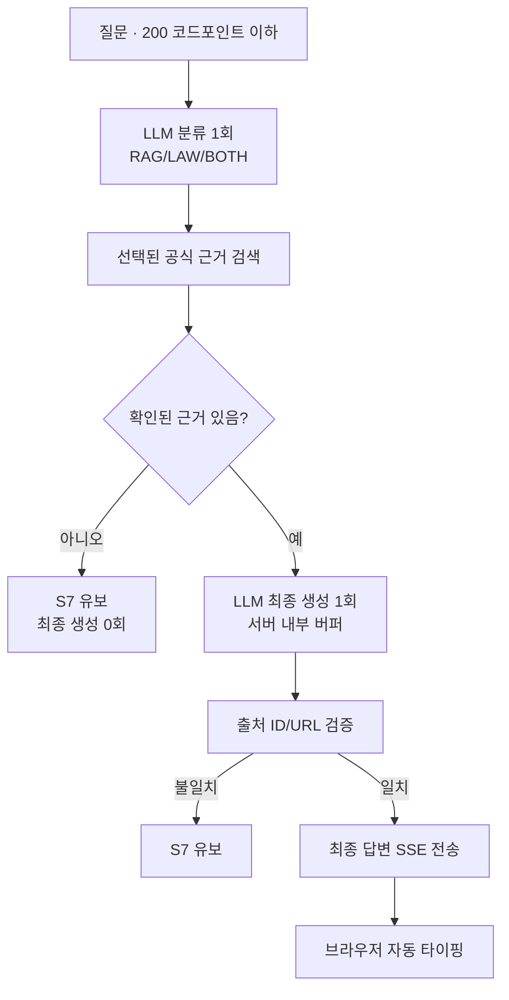

<!-- 책임: [통합] 공개 팀 간 내부 인터페이스 I01~I19의 기준선.
구현할 기능: 제공자, 소비자, 함수, 오류, 보안·검증 조건을 정한다.
완료 기준: 영역 간 구현자가 승인된 경계를 임의 변경하지 않고 연결한다. -->
# 내부 코드 인터페이스 계약 — I01~I19

**문서 버전:** v1  
**목적:** Frontend·Backend·LLM·RAG 담당자가 **같은 호출 경계**로 구현한다.  
**기준일:** 2026-10-18. 최소 실행 진입점과 후속 승인 사항 반영.  
**상태:** 내부 설계 기준선 완료. **HTTP 상세 전송 계약·ERD·전체 아키텍처 최종 승인·실연동 검증은 별개**다.

## 1. 인터페이스 지도



## 2. 공개 경계 목록

| ID | 연결점 | 유지할 계약 | 담당 |
|---|---|---|---|
| **I01** | Python ↔ TS | HTTP JSON 필드 `camelCase`; OpenAPI→TS 타입 생성. Python 내부 `snake_case` 허용 | API 담당 |
| **I02** | 체크리스트 | `ChecklistService.recommend(RecommendationInput) -> RecommendationResult`; 카드 8개 중 최대 5개 | B |
| **I03** | 카카오 입력 | `KakaoInputAdapter.parse(skill_request)` → 공통 DTO; 카카오 원문을 B 서비스에 넘기지 않음 | C |
| **I04** | 카카오→웹 | Handoff 발급·교환, **10분/원자적 1회**, 최소 데이터만 인계 | C/통합 |
| **I05** | 브라우저 인증 | Access 메모리; HttpOnly Refresh 쿠키; CSRF·정확한 CORS Origin | A/통합 |
| **I06** | 오류 | 공통 오류 코드↔HTTP 매핑; S6 기술 실패, S7 근거 부족, S9 제한 | 통합/API |
| **I07** | Backend→LLM | `ModelPort.generate()`와 `stream()`만 사용. 분류 `generate` 1회+최종 생성 `stream` 1회 | C/B |
| **I08** | 모델 수명 | 지연 생성·요청 간 공유·활성 0에서 **유휴 5분 후 종료**·앱 종료 시 즉시 정리 | C/통합 |
| **I09** | Backend→RAG | `SearchPort.search(SearchRequest) -> SearchResult` 단일 공개 검색 함수 | D/B |
| **I10** | 근거→답변 | `AnswerReference` 여러 건: ID·종류·제목·공식 URL·위치·버전 | B |
| **I11** | Backend→법령 | `LawPort.lookup(LawQuery) -> LawLookupResult`; 조문+부칙 **0~N건** | B |
| **I12** | 채팅 | `ChatAnswerService.answer()`는 조립. 프롬프트·문맥·출처 검증은 별도 파일 | B |
| **I13** | 결과→UI | SSE 진행 상태 후 **검증된 완성 답변**을 전송; Frontend 자동 타이핑 | B/A/API |
| **I14** | RAG 파싱·적재 | D 내부 경계. Backend 공개 계약이 아님 | D |
| **I15** | RAG 청킹·임베딩·저장 | D 내부 경계. Backend 공개 계약이 아님 | D |
| **I16** | RAG 게시→검색 | `published` 문서만 검색. staged/failed/retired 자료 제외 | D |
| **I17** | 업무 DB↔벡터 DB | 업무·인증 DB는 Backend, 벡터·게시 관리는 RAG; Alembic은 통합 승인 | 통합/D |
| **I18** | Zustand↔Dexie | 사용자가 저장에 동의한 데이터만 **액션 완료 시 즉시** 저장; 동의 분리 | A |
| **I19** | 앱 조립 | `create_app()`/DI/lifespan, 채팅별 취소, 종료 시 자원 해제 | 통합/B/C |

## 3. 대표 함수와 데이터

```python
# 서비스 간 계약의 모양. 실제 시그니처는 각 contracts/ports.py를 정본으로 사용.
ChecklistService.recommend(RecommendationInput)  # -> RecommendationResult
KakaoInputAdapter.parse(skill_request)            # -> RecommendationInput
ModelPort.generate(GenerationRequest)              # -> GenerationResult (async)
ModelPort.stream(GenerationRequest)                # -> AsyncIterator[GenerationChunk]
SearchPort.search(SearchRequest)                   # -> SearchResult (async)
LawPort.lookup(LawQuery)                           # -> LawLookupResult (async)
```

- **LLM:** 기본 Gemini. 개인 개발자의 Ollama/Qwen은 설정에서 **수동 선택**한다. 429 발생 시 자동 폴백·우회 재시도 금지. AI 호출 테스트 대신 다른 개발을 진행한다.
- **근거가 0건:** 분류 LLM 호출 1회는 이미 발생할 수 있다. **최종 답변 생성은 0회**, S7로 유보한다. 최종 출처 검증은 규칙 기반이다. 별도 리뷰 LLM을 호출하지 않는다.
- **RAG:** TopK 기본 3, 최대 10. 공식 안내자료 중 검수·게시된 것만 검색. 법령 원문 벡터 저장 금지.
- **법령:** `korean-law-mcp@4.15.7`로 일반 조문·연혁, **법제처 OPEN API**로 관련 부칙 **전문**. MCP의 3문장/250자 발췌는 전문이 아니다. 개정법률 후보 자동 연결은 필요할 때만 B 담당이 구현·검증한다.
- **출처:** 공식 URL·제목·근거 위치·버전을 확인한 뒤 `AnswerReference`로 전달. 추측한 링크를 만들지 않는다.

## 4. 질문→답변 흐름



- 진행 상태: **검색 중 → 법령 확인 중 → 답변 작성 중**. 정확한 SSE 이벤트명과 JSON은 API 담당자가 정한다.
- 모델 생성 도중 토큰을 화면에 직접 노출하지 않는다. **다음 글자 / 전체 즉시 보기 버튼 없음**.
- 질문 문맥은 같은 채팅의 최근 3발화까지만 사용. 추가 확인 질문은 하지 않는다.
- 기본 LLM timeout 30초, 허용 최대 300초.
- 브라우저가 채팅을 벗어나면 **해당 요청만 취소**한다. 공유 클라이언트의 다른 요청은 유지한다.

## 5. 보안·오류 경계

| 코드·상태 | HTTP | 처리 |
|---|---:|---|
| 입력 검증 | 422 | 질문 길이·DTO 오류 |
| 미인증/갱신 실패 | 401 | 로그인·Refresh 실패 |
| 권한·CSRF·Origin 위반 | 403 | 접근 거부 |
| Handoff 무효·만료·사용됨 | 400 | 동일한 거부 응답 |
| 사용자/공급자 제한 | 429 | **S9**. 제공자 자동 전환 없음 |
| 공급자 장애/시간 초과 | 503/504 | **S6** 기술 실패 |
| 근거 없음·출처 불일치 | HTTP 200의 유보 결과 | **S7** 판단 유보 |

- **인증:** 자체 JWT Access 15분, Refresh 7일·회전형, Argon2id. 서버에 채팅 원문을 영구 저장하지 않는다.
- **쿠키:** Backend 호스트의 `HttpOnly; Secure; SameSite=None` 기본안. 실제 타사 쿠키 제한을 Chrome·Safari·Firefox·카카오 인앱에서 시험한 뒤 CHIPS 필요성을 판단한다.
- **DB:** Supabase PostgreSQL **Session Pooler 5432**, 자체 인증. ERD 미승인 단계에서는 SQL 테이블·Alembic revision을 만들지 않는다.
- **저장:** Zustand는 메모리, Dexie는 독립 저장 동의 후에만 사용. 카카오 Handoff 복원도 동의 전 자동 영속 저장하지 않는다.
- **체크리스트:** 초기 질문 3개, 위험 질문 최대 3개. `안내 확인`은 읽음 표시이며 법률 절차 완료를 뜻하지 않는다.

## 6. 범위·변경 승인

- **내부 계약 결정 완료**와 **실제 기능 작동 완료**는 다르다. 현재 `/health`, 초기 화면, LLM/RAG `status`는 최소 진입점이다.
- HTTP URL·Method·JSON·SSE 상세: **API 담당자**가 확정한다.
- Port·DTO 변경: 제공자/소비자·통합 관리자 승인 후 별도 PR에서 처리한다.
- 실연동 테스트: 로그인/Refresh, 법령 조회, 부칙 전문, RAG published-only, Gemini 제한, SSE 취소, 브라우저 쿠키, CI 빌드.
- **전체 아키텍처·ERD의 최종 승인 여부를 계약 완료로 대체하지 않는다.**
